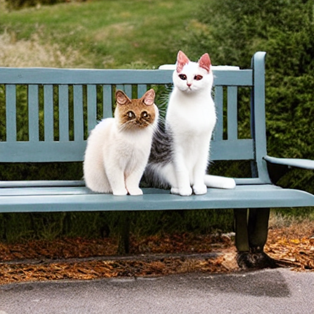
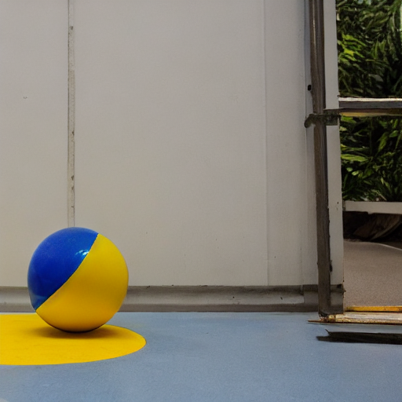
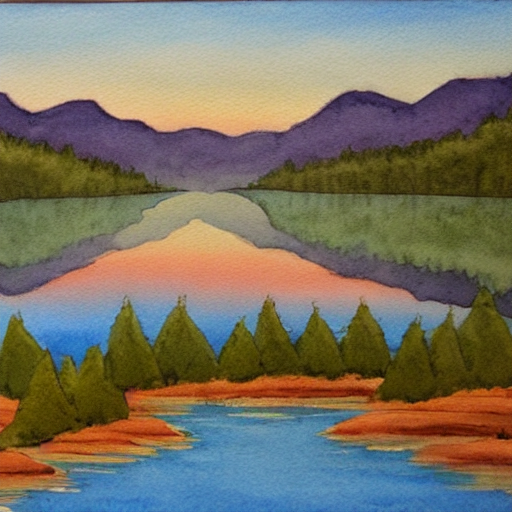
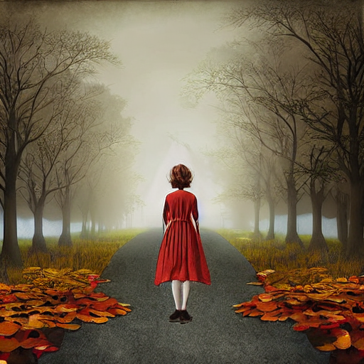

# Milestone 1 — Baseline prompt → image runs

## baseline

### p1_simple_object
**Prompt:** a red apple on a wooden table  
Scheduler: PNDMScheduler | Steps: 30 | Guidance: 7.5 | Seed: 42

### p2_multi_object
**Prompt:** a cat and a dog sitting together on a park bench  
Scheduler: PNDMScheduler | Steps: 30 | Guidance: 7.5 | Seed: 42

### p3_spatial
**Prompt:** a blue cube to the left of a yellow sphere on a white floor  
Scheduler: PNDMScheduler | Steps: 30 | Guidance: 7.5 | Seed: 42

### p4_stylistic
**Prompt:** a mountain lake at sunrise, in the style of a watercolor painting  
Scheduler: PNDMScheduler | Steps: 30 | Guidance: 7.5 | Seed: 42

### p5_abstract
**Prompt:** the feeling of nostalgia, surreal dreamlike digital art  
Scheduler: PNDMScheduler | Steps: 30 | Guidance: 7.5 | Seed: 42

