# Milestone 2 — Conditional generation

## baseline

### p1_simple_object
**Prompt:** a red apple on a wooden table  
Scheduler: PNDMScheduler | Steps: 30 | Guidance: 7.5 | Seed: 42

### p2_multi_object
**Prompt:** a cat and a dog sitting together on a park bench  
Scheduler: PNDMScheduler | Steps: 30 | Guidance: 7.5 | Seed: 42

### p3_spatial
**Prompt:** a blue cube to the left of a yellow sphere on a white floor  
Scheduler: PNDMScheduler | Steps: 30 | Guidance: 7.5 | Seed: 42

### p4_stylistic
**Prompt:** a mountain lake at sunrise, in the style of a watercolor painting  
Scheduler: PNDMScheduler | Steps: 30 | Guidance: 7.5 | Seed: 42

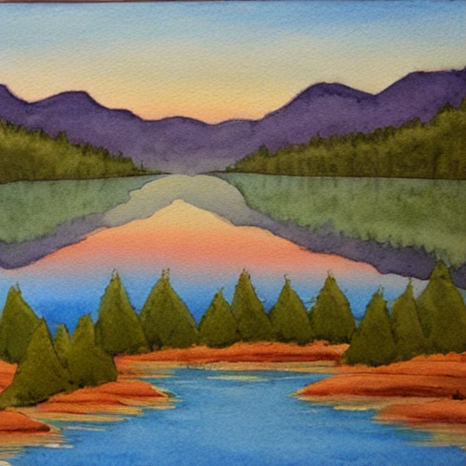

### p5_abstract
**Prompt:** the feeling of nostalgia, surreal dreamlike digital art  
Scheduler: PNDMScheduler | Steps: 30 | Guidance: 7.5 | Seed: 42

## guidance_sweep

### p1_simple_object_cfg1.0
**Prompt:** a red apple on a wooden table  
Scheduler: PNDMScheduler | Steps: 30 | Guidance: 1.0 | Seed: 42

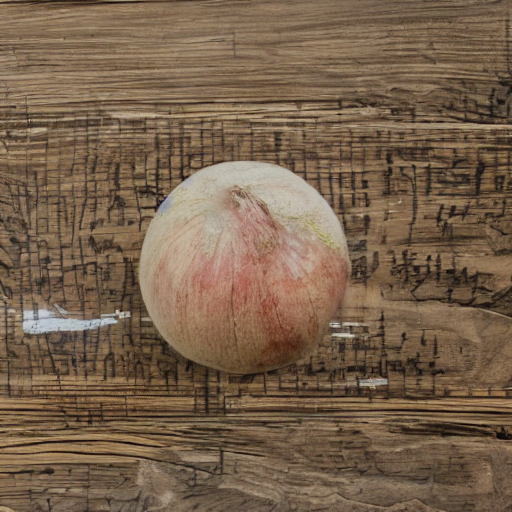

### p1_simple_object_cfg3.0
**Prompt:** a red apple on a wooden table  
Scheduler: PNDMScheduler | Steps: 30 | Guidance: 3.0 | Seed: 42

### p1_simple_object_cfg5.0
**Prompt:** a red apple on a wooden table  
Scheduler: PNDMScheduler | Steps: 30 | Guidance: 5.0 | Seed: 42

### p1_simple_object_cfg7.5
**Prompt:** a red apple on a wooden table  
Scheduler: PNDMScheduler | Steps: 30 | Guidance: 7.5 | Seed: 42

### p1_simple_object_cfg10.0
**Prompt:** a red apple on a wooden table  
Scheduler: PNDMScheduler | Steps: 30 | Guidance: 10.0 | Seed: 42

### p1_simple_object_cfg15.0
**Prompt:** a red apple on a wooden table  
Scheduler: PNDMScheduler | Steps: 30 | Guidance: 15.0 | Seed: 42

### p2_multi_object_cfg1.0
**Prompt:** a cat and a dog sitting together on a park bench  
Scheduler: PNDMScheduler | Steps: 30 | Guidance: 1.0 | Seed: 42

### p2_multi_object_cfg3.0
**Prompt:** a cat and a dog sitting together on a park bench  
Scheduler: PNDMScheduler | Steps: 30 | Guidance: 3.0 | Seed: 42

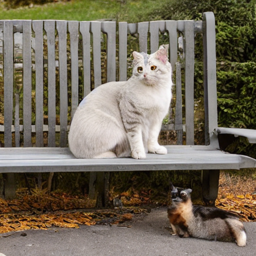

### p2_multi_object_cfg5.0
**Prompt:** a cat and a dog sitting together on a park bench  
Scheduler: PNDMScheduler | Steps: 30 | Guidance: 5.0 | Seed: 42

### p2_multi_object_cfg7.5
**Prompt:** a cat and a dog sitting together on a park bench  
Scheduler: PNDMScheduler | Steps: 30 | Guidance: 7.5 | Seed: 42

### p2_multi_object_cfg10.0
**Prompt:** a cat and a dog sitting together on a park bench  
Scheduler: PNDMScheduler | Steps: 30 | Guidance: 10.0 | Seed: 42

### p2_multi_object_cfg15.0
**Prompt:** a cat and a dog sitting together on a park bench  
Scheduler: PNDMScheduler | Steps: 30 | Guidance: 15.0 | Seed: 42

### p3_spatial_cfg1.0
**Prompt:** a blue cube to the left of a yellow sphere on a white floor  
Scheduler: PNDMScheduler | Steps: 30 | Guidance: 1.0 | Seed: 42

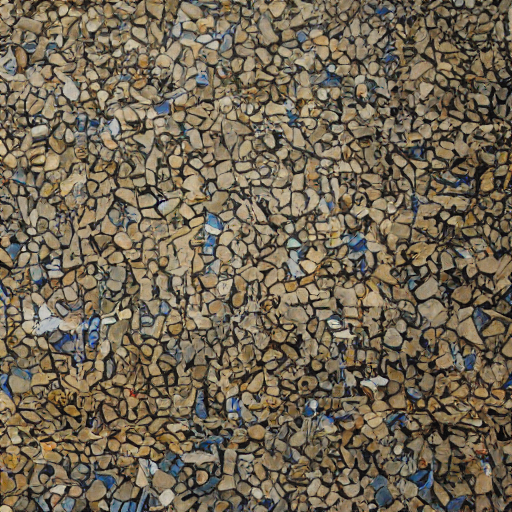

### p3_spatial_cfg3.0
**Prompt:** a blue cube to the left of a yellow sphere on a white floor  
Scheduler: PNDMScheduler | Steps: 30 | Guidance: 3.0 | Seed: 42

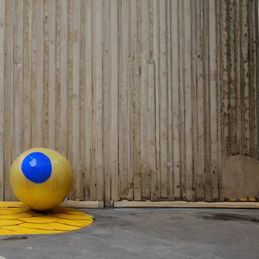

### p3_spatial_cfg5.0
**Prompt:** a blue cube to the left of a yellow sphere on a white floor  
Scheduler: PNDMScheduler | Steps: 30 | Guidance: 5.0 | Seed: 42

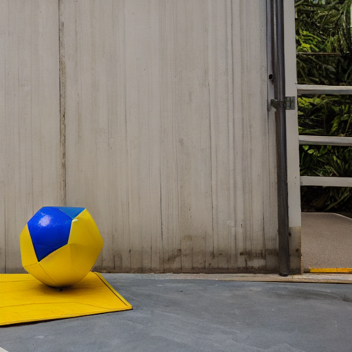

### p3_spatial_cfg7.5
**Prompt:** a blue cube to the left of a yellow sphere on a white floor  
Scheduler: PNDMScheduler | Steps: 30 | Guidance: 7.5 | Seed: 42

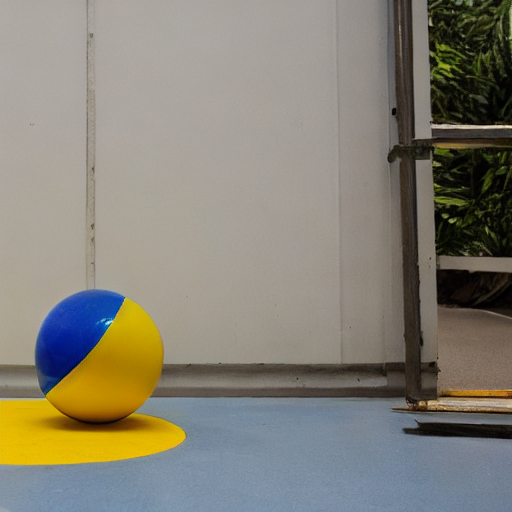

### p3_spatial_cfg10.0
**Prompt:** a blue cube to the left of a yellow sphere on a white floor  
Scheduler: PNDMScheduler | Steps: 30 | Guidance: 10.0 | Seed: 42

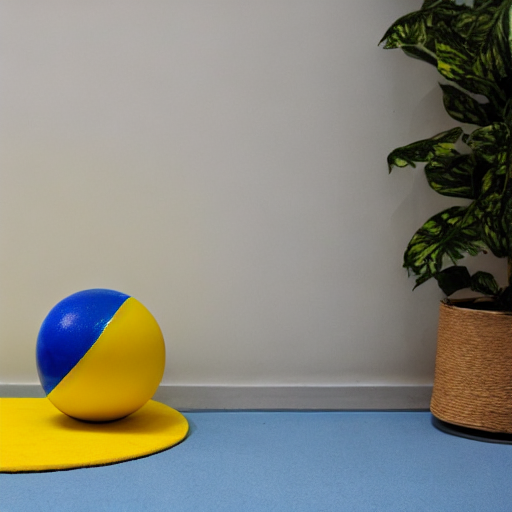

### p3_spatial_cfg15.0
**Prompt:** a blue cube to the left of a yellow sphere on a white floor  
Scheduler: PNDMScheduler | Steps: 30 | Guidance: 15.0 | Seed: 42

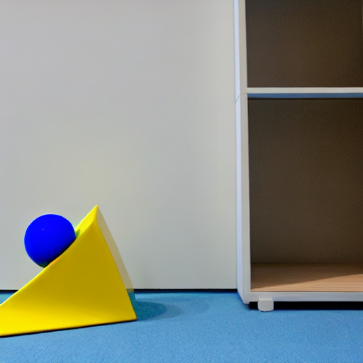

### p4_stylistic_cfg1.0
**Prompt:** a mountain lake at sunrise, in the style of a watercolor painting  
Scheduler: PNDMScheduler | Steps: 30 | Guidance: 1.0 | Seed: 42

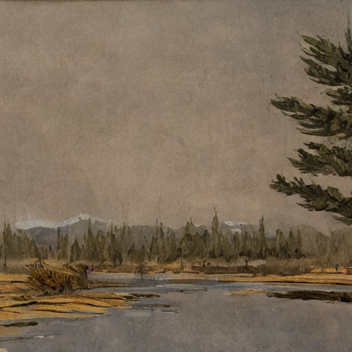

### p4_stylistic_cfg3.0
**Prompt:** a mountain lake at sunrise, in the style of a watercolor painting  
Scheduler: PNDMScheduler | Steps: 30 | Guidance: 3.0 | Seed: 42

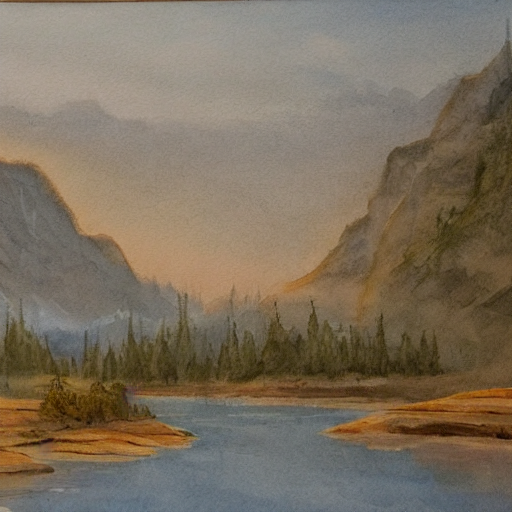

### p4_stylistic_cfg5.0
**Prompt:** a mountain lake at sunrise, in the style of a watercolor painting  
Scheduler: PNDMScheduler | Steps: 30 | Guidance: 5.0 | Seed: 42

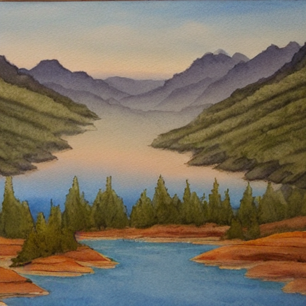

### p4_stylistic_cfg7.5
**Prompt:** a mountain lake at sunrise, in the style of a watercolor painting  
Scheduler: PNDMScheduler | Steps: 30 | Guidance: 7.5 | Seed: 42

### p4_stylistic_cfg10.0
**Prompt:** a mountain lake at sunrise, in the style of a watercolor painting  
Scheduler: PNDMScheduler | Steps: 30 | Guidance: 10.0 | Seed: 42

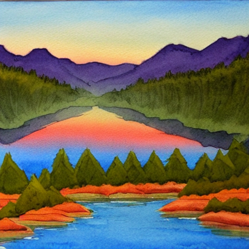

### p4_stylistic_cfg15.0
**Prompt:** a mountain lake at sunrise, in the style of a watercolor painting  
Scheduler: PNDMScheduler | Steps: 30 | Guidance: 15.0 | Seed: 42

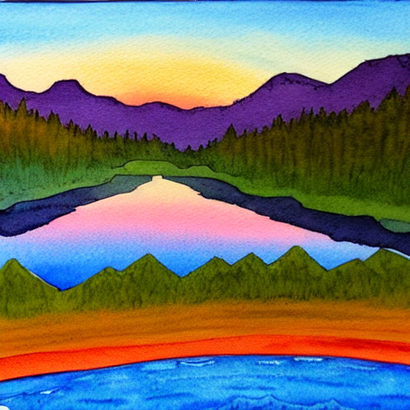

### p5_abstract_cfg1.0
**Prompt:** the feeling of nostalgia, surreal dreamlike digital art  
Scheduler: PNDMScheduler | Steps: 30 | Guidance: 1.0 | Seed: 42

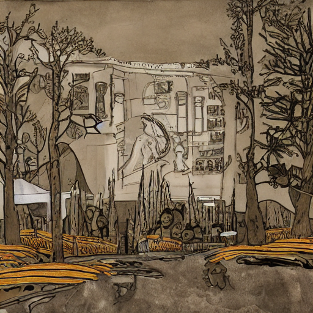

### p5_abstract_cfg3.0
**Prompt:** the feeling of nostalgia, surreal dreamlike digital art  
Scheduler: PNDMScheduler | Steps: 30 | Guidance: 3.0 | Seed: 42

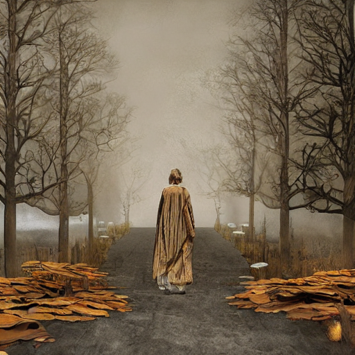

### p5_abstract_cfg5.0
**Prompt:** the feeling of nostalgia, surreal dreamlike digital art  
Scheduler: PNDMScheduler | Steps: 30 | Guidance: 5.0 | Seed: 42

### p5_abstract_cfg7.5
**Prompt:** the feeling of nostalgia, surreal dreamlike digital art  
Scheduler: PNDMScheduler | Steps: 30 | Guidance: 7.5 | Seed: 42

### p5_abstract_cfg10.0
**Prompt:** the feeling of nostalgia, surreal dreamlike digital art  
Scheduler: PNDMScheduler | Steps: 30 | Guidance: 10.0 | Seed: 42

### p5_abstract_cfg15.0
**Prompt:** the feeling of nostalgia, surreal dreamlike digital art  
Scheduler: PNDMScheduler | Steps: 30 | Guidance: 15.0 | Seed: 42

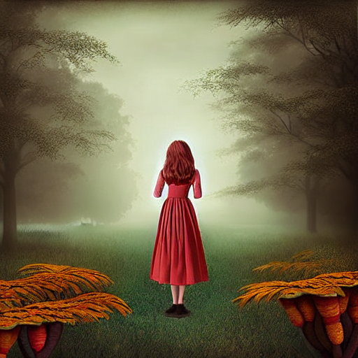
