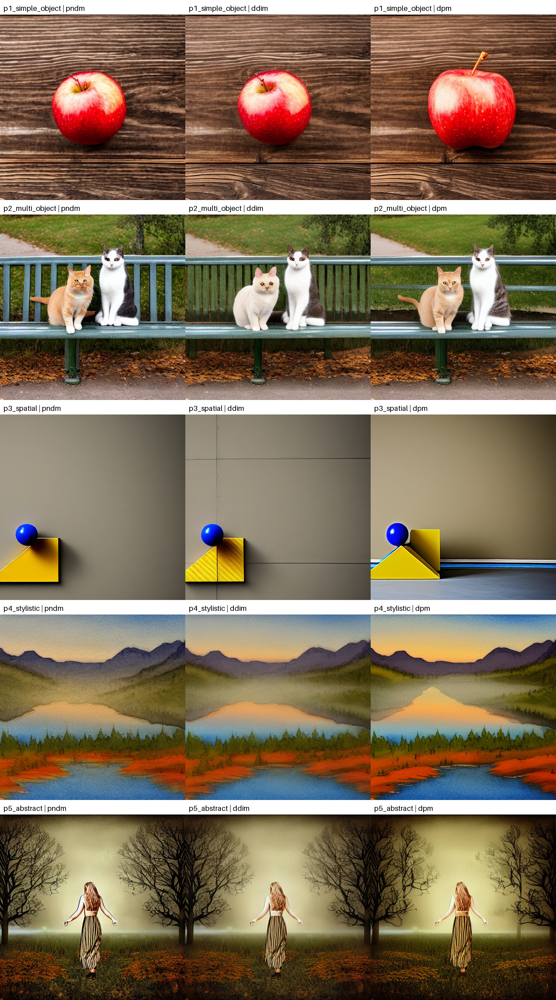

# Milestone 2: Model Integration and Baseline Results

**IE 7615 Deep Learning for AI, Generative Project · Group 10 · November 2026**

The formatted version of this report is [`IE7615_Group-10_Generative_Milestone-2_Report.pdf`](IE7615_Group-10_Generative_Milestone-2_Report.pdf).

## Summary

We integrated a CLIP text encoder with a pretrained Stable Diffusion v1.5 UNet, VAE and scheduler in a custom denoising loop, verified it against the reference pipeline, and used it for baseline conditional generation on five prompts, a six-point classifier-free guidance sweep and a three-sampler noise-schedule comparison (50 images). Guidance scale had the largest effect on fidelity, with s = 7.5 giving the best balance. The sampler changed the content of some samples but not their quality at 30 steps. The clearest failures were in prompt alignment: under every sampler the model dropped the dog from the multi-object prompt and swapped the shapes of the two coloured objects in the spatial prompt.

## 1. Pipeline integration

No weights are trained; the model is used for inference only. Rather than calling Diffusers' high-level pipeline, we load the four components separately and connect them in our own loop (`src/pipeline.py`). The CLIP ViT-L/14 encoder maps each prompt to a 77 × 768 embedding, which conditions the UNet through cross-attention (the encoder's hidden size of 768 matches the UNet's cross-attention dimension). At every step the UNet receives the conditional and unconditional embeddings as one batch of two, and the predictions are combined with classifier-free guidance:

```
ε̂ = ε(z_t, c_neg) + s · [ ε(z_t, c) − ε(z_t, c_neg) ]
```

where `c_neg` is the embedding of the negative prompt (or of the empty string). The scheduler then updates the 4 × 64 × 64 latent, and the VAE decodes the final latent to a 512 × 512 image. As a correctness check, the loop reproduces the reference pipeline's output with a mean absolute pixel difference of 0.31/255.

## 2. Experimental setup

All runs use Stable Diffusion v1.5 with CLIP ViT-L/14 at 512 × 512 in fp16 on an NVIDIA Tesla T4 (Colab), seed 42, and by default PNDM with 30 steps and s = 7.5 (PyTorch 2.14.1, Diffusers 0.31.0, Transformers 4.46.3).

| ID | Prompt | Tests |
|---|---|---|
| P1 | a red apple on a wooden table | single object |
| P2 | a cat and a dog sitting together on a park bench | multiple objects |
| P3 | a blue cube to the left of a yellow sphere on a white floor | spatial relation, attribute binding |
| P4 | a mountain lake at sunrise, in the style of a watercolor painting | artistic style |
| P5 | the feeling of nostalgia, surreal dreamlike digital art | abstract concept |

We ran (a) the baseline: each prompt at default settings; (b) a guidance sweep over s ∈ {1.0, 3.0, 5.0, 7.5, 10.0, 15.0}; and (c) a sampler sweep over PNDM, DDIM and DPM-Solver (multistep) with every other setting fixed (`src/schedulers.py`). All three samplers share the trained noise schedule and the same initial latent; only the discretization of the reverse process changes. The baseline uses the negative prompt "blurry, lowres, distorted, watermark, text"; the sampler sweep was run without one, so the samplers are comparable with each other, but its PNDM images differ from the baseline images.

## 3. Results

### 3.1 Baseline conditional generation

All five prompts produced coherent, high-quality images through the custom loop; these are the reference point for both sweeps. Outputs: `outputs/milestone2_conditioning/baseline/`.

### 3.2 Classifier-free guidance

At s = 1.0 the guidance term cancels and the model samples from the conditional prediction alone; images were low in contrast and followed the prompt only loosely. Raising s strengthened prompt adherence and colour saturation. At s ≥ 10 images became oversaturated, with harsher edges and less natural texture. We keep s = 7.5 as the default, as it gave the best trade-off between prompt fidelity and image naturalness. Outputs: `outputs/milestone2_conditioning/guidance_sweep/`.

### 3.3 Sampler and noise-schedule comparison



*Sampler sweep. Rows are prompts P1–P5; columns are PNDM, DDIM and DPM-Solver. Seed (42), steps (30) and guidance (s = 7.5) are identical across samplers.*

PNDM and DDIM converged to nearly identical images on four of the five prompts. DPM-Solver produced the largest deviations, most visibly on the compositional prompts: it recomposed the spatial scene (P3) and changed the object's scale and detail in P1. The one notable PNDM–DDIM difference was also on a compositional prompt, where DDIM rendered one of the cats in a different colour (P2). The style-driven prompts (P4, P5) were nearly insensitive to the sampler. Latency did not depend on the sampler (DPM-Solver 4.58 s, DDIM 4.59 s, PNDM 4.73 s per image after warm-up), as each makes one batched UNet call per step.

| Prompt | DDIM relative to PNDM | DPM-Solver relative to PNDM |
|---|---|---|
| P1 object | Nearly identical | Larger, more saturated apple with a visible stem |
| P2 multi-object | Same layout; left cat white instead of orange | Same content and layout; minor texture changes |
| P3 spatial | Same composition; faint seams added to the wall | Recomposed; new block shape, added floor |
| P4 style | Nearly identical | Slightly warmer palette, sharper reflection |
| P5 abstract | Nearly identical | Slightly darker, higher contrast |

Outputs: `outputs/milestone2_conditioning/noise_sweep/` (images, `grid.png`, `run_log.json`, `GALLERY.md`).

### 3.4 Prompt alignment

Two failures appear under all three samplers. For P2 every image shows two cats and no dog. For P3 the left-to-right placement of the colours is correct, but the shapes are swapped: each image contains a blue sphere and a yellow block instead of a blue cube and a yellow sphere, and no white floor appears. P1 and P4 are rendered faithfully, and P5 gives a plausible, if subjective, interpretation.

## 4. Discussion

Guidance scale is the stronger and more predictable control, trading naturalness and diversity for prompt adherence. Sampler choice changes which sample is produced, mainly for layout-constrained prompts, but not its quality at 30 steps, so samplers should be compared with distribution-level metrics at lower step counts. The alignment failures are identical across samplers, which places their cause in the text conditioning rather than in sampling: CLIP's contrastive training is known to bind attributes to objects, and counts to categories, only weakly.

**Next steps.** Milestone 3 adds FID and Inception Score on the 2,000-pair COCO subset, CLIPScore for alignment, a step-count sweep (10–50) per sampler, and Stable Diffusion 2.1 to test whether a stronger text encoder fixes these failures.
